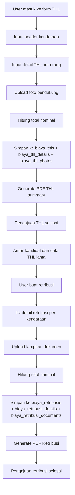

# Dokumentasi Gabungan Sistem THL dan Retribusi

> **Status dokumentasi (17 September 2026):** Referensi `web/...`, Inertia,
> Vue, dan route web pada bagian lama adalah catatan sistem sebelumnya.
> Implementasi aktif repository ini menggunakan Laravel API pada
> `app/Http/Controllers/Api/V1` dan Next.js pada `onezentra-web`.

## Implementasi Aktif Repository Ini

### Input THL

- Form aktif: `onezentra-web/src/app/biaya-thl/page.tsx`.
- Endpoint aktif: `POST /api/v1/biaya-thl` dan `PUT /api/v1/biaya-thl/{id}`.
- Controller aktif: `app/Http/Controllers/Api/V1/BiayaThlController.php`.
- Detail THL menyimpan `nama_thl`, `driver_name`, `nopol_kendaraan`,
  `type_kendaraan`, `kubikasi`, `droppoint`, `posisi`, `jam_datang`,
  `jam_pulang`, `nominal_biaya`, dan `order`.
- Jam datang dan pulang ditampilkan untuk semua posisi THL yang dipilih,
  termasuk `THL GUDANG`. Nama driver hanya untuk `THL HELPER` dan
  `THL DRIVER`.
- Plat (`nopol_kendaraan`) dan type (`type_kendaraan`) kendaraan diisi
  per baris untuk SEMUA posisi, termasuk `THL GUDANG`. Tidak ada input
  kendaraan level grup SJ.
- Saat posisi `THL GUDANG` dipilih, frontend mengisi `kubikasi=0` dan
  `droppoint=0`.
- Foto detail dikirim sebagai `details[i][photos][]` dan disimpan pada
  `biaya_thl_photos` melalui relasi detail. Satu baris valid wajib memiliki
  satu foto bukti sebelum dikirim (divalidasi frontend + gerbang submit).

### Input Retribusi

- Form aktif: `onezentra-web/src/app/biaya-retribusi/page.tsx`.
- Endpoint aktif: `POST /api/v1/biaya-retribusi` dan
  `PUT /api/v1/biaya-retribusi/{id}`.
- Kandidat berasal dari `BiayaThlDetail` yang memiliki status THL `approved`.
- Detail Retribusi menyimpan `biaya_thl_id` dan `biaya_thl_detail_id` jika
  dibuat dari kandidat THL. Baris manual tidak memiliki hubungan tersebut,
  sehingga tidak dapat mengisi data THL secara otomatis pada PDF gabungan.
- Endpoint index Retribusi memuat `details.biayaThlDetail.photos` agar foto
  THL sumber dapat digunakan saat membuat PDF.

### PDF Dan Format Target

- Endpoint PDF backend tersedia pada `/api/v1/biaya-thl/{id}/pdf` dan
  `/api/v1/biaya-retribusi/{id}/pdf`.
- Tombol Next.js menggunakan `onezentra-web/src/lib/biayaPdf.ts`.
- Karena ada renderer frontend `jsPDF` dan renderer backend Dompdf/Blade,
  keduanya harus dijaga konsisten. Mengubah salah satunya tidak otomatis
  mengubah renderer lainnya.
- Format target yang disepakati adalah satu halaman A4 landscape:
  1. Form Klaim Biaya Pengajuan Retribusi di bagian atas.
  2. Tabel nomor kendaraan, jenis kendaraan, surat jalan, nominal, dan paraf.
  3. Total dan area approval Mengajukan, Mengetahui, dan Menyetujui.
  4. Form Klaim Tenaga Harian Lepas di bagian bawah.
  5. Tabel nomor, nama, kubikasi, drop point, posisi, jam datang, dan jam pulang.
  6. Kotak foto THL langsung di bawah tabel THL.

## Audit Penyebab PDF Tidak Sama Dengan Target

Temuan yang sudah diverifikasi terhadap kode aktif:

1. **Ada dua renderer PDF.** Frontend memakai `jsPDF`, sedangkan endpoint
   backend memakai Dompdf dan Blade. Hasil dapat berbeda jika hanya salah satu
   renderer yang diubah.
2. **Data THL pada PDF Retribusi bersifat turunan.** Nama pekerja, posisi, jam,
   kubikasi, drop point, dan foto hanya tersedia jika detail Retribusi memiliki
   `biaya_thl_detail_id` yang valid.
3. **Baris manual Retribusi tidak memiliki sumber THL.** Baris tersebut hanya
   memiliki nopol, tipe, surat jalan, dan nominal; data pekerja THL tidak dapat
   ditebak oleh renderer.
4. **Approval tidak boleh hardcode.** Nama pengaju berasal dari
   `approval_pengajuan`, sedangkan nama pemeriksa dan penyetuju berasal dari
   `biaya_thl_pdf_settings` dengan fallback `config/biaya_thl_pdf.php`.
5. **Foto baru dan foto lama berbeda bentuk.** Foto baru berupa `File` di
   browser. Foto tersimpan berupa object dengan `file_path` dan harus dibaca
   dari storage.
6. **Nilai input menentukan isi PDF.** Layout tidak dapat memperbaiki data yang
   kosong atau hubungan THL yang tidak tersimpan.
7. **Tanggal harus berasal dari `tanggal_pengajuan`.** Nilai kosong atau tidak
   valid harus dianggap sebagai data input bermasalah, bukan diisi sembarang
   oleh renderer.

### Checklist Audit Sebelum PDF Dianggap Benar

- Detail THL memiliki nama, nopol, posisi, kubikasi, drop point, jam datang,
  dan jam pulang.
- THL Gudang tersimpan dengan `kubikasi=0` dan `droppoint=0`.
- Setiap baris Retribusi yang harus menampilkan data THL memiliki
  `biaya_thl_detail_id`.
- Response detail Retribusi memuat `biaya_thl_detail.photos`.
- Approval depo sudah diatur pada `biaya_thl_pdf_settings`.
- Preview dan Cetak memakai renderer serta payload yang sama.
- PDF diperiksa dalam mode landscape sebagai satu halaman, bukan hanya dari
  tampilan modal browser.

## Tujuan

Dokumen ini menjelaskan satu alur utuh pengajuan biaya THL sampai menjadi pengajuan retribusi, serta PDF yang dihasilkan di tiap tahap. Tujuannya agar asisten atau developer baru dapat membangun ulang sistem ini di project lain tanpa kehilangan konteks bisnis dan logika teknis.

Dokumen ini adalah versi gabungan berdasarkan implementasi asli yang ada di:

- [web/app/Http/Controllers/BiayaThlController.php](../web/app/Http/Controllers/BiayaThlController.php)
- [web/app/Http/Controllers/BiayaRetribusiController.php](../web/app/Http/Controllers/BiayaRetribusiController.php)
- [web/routes/web.php](../web/routes/web.php)
- [web/resources/views/pdf/biaya_thl_summary.blade.php](../web/resources/views/pdf/biaya_thl_summary.blade.php)
- [web/resources/views/pdf/biaya_retribusi.blade.php](../web/resources/views/pdf/biaya_retribusi.blade.php)
- [web/STRUKTUR_FORM_BIAYA_THL.md](../web/STRUKTUR_FORM_BIAYA_THL.md)
- [BIAYA_THL_FORM_COMPLETE.md](../BIAYA_THL_FORM_COMPLETE.md)
- [BIAYA_THL_DEPLOYMENT_GUIDE.md](../BIAYA_THL_DEPLOYMENT_GUIDE.md)

---

## 1. Gambaran Bisnis

Sistem ini terbagi menjadi dua alur utama:

1. THL Claim
   - Pengajuan biaya untuk tenaga harian lepas / pekerja harian.
   - Berisi header kendaraan dan detail THL per orang.
   - Memiliki dokumentasi foto pendukung.

2. Retribusi Claim
   - Pengajuan biaya retribusi untuk kendaraan / dokumen pendukung.
   - Data kandidat diambil dari data THL yang sudah pernah dibuat.
   - Menggunakan lampiran dokumen seperti BA, SJ, invoice, atau dokumen lain.

Keduanya sama-sama dibuat dalam bentuk pengajuan dan PDF, tetapi bukan dua sistem yang berdiri sendiri. Retribusi berhubungan langsung dengan data THL sebagai sumber kandidat.

---

## 2. Flow End-to-End



---

## 2.1 Proses awal input dari form sampai simpan

Bagian ini adalah urutan implementasi yang harus diikuti asisten. Jangan mulai dari PDF sebelum proses input dan penyimpanan berhasil.

### THL: dari halaman form sampai database

1. User membuka `GET /pengajuan-biaya-thl/create`.
2. `BiayaThlController::create()` mengirim identitas user login ke halaman: `kodDepo`, `namaDepo`, dan `namaUser`. User tidak mengetik ulang data tersebut.
3. Halaman `BiayaThl/Create.vue` membuat payload awal:
   - `tanggal_pengajuan`
   - `details: []`
   - `photos: []`
4. User mengisi minimal satu detail dan maksimal 20 detail. Field utama setiap detail adalah `nama_thl`, `nopol_kendaraan`, `type_kendaraan`, `posisi`, dan `nominal_biaya`. Untuk posisi `THL HELPER` atau `THL DRIVER`, form juga mewajibkan surat jalan, nama driver, kubikasi, drop point, jam datang, dan jam pulang.
5. Untuk posisi `THL GUDANG`, setiap `kendaraan_tambahan` harus memiliki `nopol`, `type`, dan `surat_jalan` jika baris tambahan dibuat.
6. User mengunggah foto bukti. Pada frontend, jumlah foto harus sama dengan jumlah baris detail yang valid. Ini adalah aturan UI yang penting: satu baris valid harus memiliki satu foto.
7. Saat tombol `Simpan Klaim` diklik, frontend mengirim `POST /pengajuan-biaya-thl` menggunakan Inertia `form.post()`.
8. Backend menjalankan validasi server. Jika gagal, data tidak disimpan dan error dikembalikan ke form.
9. Backend menghitung total dengan menjumlahkan semua `details.*.nominal_biaya`, lalu membuat satu header di `biaya_thls` dengan status awal `draft` dan `created_by` dari user login.
10. Backend membuat satu row `biaya_thl_details` untuk setiap detail, memakai `biaya_thl_id` dan `order` untuk relasi serta urutan.
11. Backend menyimpan setiap foto ke `storage/app/public/biaya_thl/{id}` dan membuat catatan di `biaya_thl_photos`.
12. Backend redirect ke `GET /pengajuan-biaya-thl/{id}`. Halaman detail menampilkan row THL, total, dan foto.

### Retribusi: dari kandidat THL sampai database

1. User membuka `GET /pengajuan-biaya-retribusi/create`.
2. `BiayaRetribusiController::create()` menjalankan `candidateRows()` dan mengirim maksimal 80 kandidat detail THL terbaru dari depo user.
3. Kandidat hanya berasal dari tipe kendaraan yang mengandung `CDD`, `Fuso`, `Container 20`, atau `Container 40`.
4. Di halaman `BiayaRetribusi/Create.vue`, user dapat memilih kandidat THL lalu menekan `Ambil yang Dipilih`. Sistem menyalin data kandidat menjadi detail retribusi. User juga dapat menambah baris manual.
5. Payload setiap detail retribusi berisi `biaya_thl_id`, `biaya_thl_detail_id`, `nopol_kendaraan`, `type_kendaraan`, `no_surat_jalan`, dan `nominal_biaya`. ID THL boleh kosong untuk baris manual.
6. User dapat menambah lampiran dengan tipe `ba`, `sj`, `invoice`, `manifest`, atau `lainnya`. File yang dikirim dapat berupa PDF atau gambar.
7. Saat tombol `Simpan Retribusi` diklik, frontend mengirim `POST /pengajuan-biaya-retribusi` sebagai multipart form-data.
8. Backend memvalidasi maksimal 20 detail, menghitung total nominal dari detail, lalu membuat header `biaya_retribusis` dengan status `draft` dan `created_by` user login.
9. Backend membuat row `biaya_retribusi_details` untuk setiap detail. Jika berasal dari kandidat, `biaya_thl_id` dan `biaya_thl_detail_id` menjaga hubungan ke THL asal.
10. Backend menyimpan file ke `storage/app/public/biaya_retribusi/{id}` dan metadata ke `biaya_retribusi_documents`.
11. Backend redirect ke `GET /pengajuan-biaya-retribusi/{id}`. Halaman detail menampilkan detail retribusi, sumber THL, dan lampiran.

### Aturan yang harus dibaca sebagai aturan backend

- Total nominal tidak boleh dipercaya dari frontend; backend harus menghitung ulang dari detail.
- THL menyimpan `is_rfah_required` jika total `> 750000`.
- Retribusi backend menyimpan `is_rfah_required` jika total `> 1000000`. UI Retribusi saat ini menampilkan warning pada `> 750000`, jadi nilai threshold UI dan backend tidak sama dan harus diputuskan saat membangun ulang.
- Validasi foto THL satu foto per baris ada di frontend; rule backend saat ini hanya memvalidasi file foto. Jika aturan satu foto per baris wajib secara bisnis, tambahkan validasi backend juga.
- Edit dan hapus hanya boleh dilakukan oleh user yang sama dengan `created_by`.

### Masalah implementasi yang wajib diberitahukan kepada asisten

- Route `GET /pengajuan-biaya-thl/{id}/pdf-detail` terdaftar di `web/routes/web.php`, tetapi controller yang ditelusuri hanya memiliki `pdfSummary()`, bukan `pdfDetail()`. Jangan menganggap route PDF detail sudah berfungsi; implementasikan method tersebut atau hapus route-nya.
- Tombol PDF yang dipakai halaman THL saat ini memanggil `biaya-thl.pdf.summary`.
- Tombol PDF yang dipakai halaman Retribusi saat ini memanggil `biaya-retribusi.pdf`.

---

---

## 3. Alur THL secara detail

### 3.1 Route THL

Dari [web/routes/web.php](../web/routes/web.php):

- GET /pengajuan-biaya-thl
- GET /pengajuan-biaya-thl/create
- POST /pengajuan-biaya-thl
- GET /pengajuan-biaya-thl/{id}
- GET /pengajuan-biaya-thl/{id}/edit
- PUT /pengajuan-biaya-thl/{id}
- DELETE /pengajuan-biaya-thl/{id}
- GET /pengajuan-biaya-thl/{id}/pdf-summary
- GET /pengajuan-biaya-thl/{id}/pdf-detail

### 3.2 Controller THL

Semua logika utama ada di [web/app/Http/Controllers/BiayaThlController.php](../web/app/Http/Controllers/BiayaThlController.php).

Fungsi penting:

- index()
  - Menampilkan daftar pengajuan THL.
  - Filter berdasarkan kode depo user.

- create()
  - Menampilkan form pembuatan THL.

- store()
  - Validasi input.
  - Menghitung total nominal dari semua detail.
  - Membuat record header di `biaya_thls`.
  - Membuat record detail di `biaya_thl_details`.
  - Menyimpan foto di `biaya_thl_photos`.
  - Status awal `draft`.

- update()
  - Update header.
  - Hapus lalu buat ulang detail.
  - Hapus foto lama dan tambah foto baru.

- destroy()
  - Hapus data THL beserta foto terkait.

- pdfSummary()
  - Men-generate PDF untuk ringkasan THL.

- exportExcel()
  - Mengekspor data THL ke Excel.

### 3.3 Struktur data THL

#### tabel utama

- `biaya_thls`
  - id
  - tanggal_pengajuan
  - kode_depo
  - nama_depo
  - no_kendaraan
  - type_kendaraan
  - no_surat_jalan
  - kubikasi_base
  - nominal_biaya
  - is_rfah_required
  - rfah_name
  - approval_pengajuan
  - created_by
  - status

- `biaya_thl_details`
  - id
  - biaya_thl_id
  - nama_thl
  - driver_name
  - nopol_kendaraan
  - type_kendaraan
  - kubikasi
  - droppoint
  - posisi
  - jam_datang
  - jam_pulang
  - nominal_biaya
  - kendaraan_tambahan
  - kendaraan_sj
  - kendaraan_nopol
  - kendaraan_type
  - order

- `biaya_thl_photos`
  - id
  - biaya_thl_id
  - file_path
  - file_name
  - mime_type
  - file_size
  - order

### 3.4 Aturan bisnis THL

- Minimal 1 baris detail, maksimal 20.
- Setiap detail wajib memiliki nama THL, nopol, jenis kendaraan, nominal.
- Plat (`nopol_kendaraan`) dan type (`type_kendaraan`) kendaraan diisi
  per baris untuk SEMUA posisi, termasuk `THL GUDANG`. Tidak ada input
  kendaraan level grup SJ.
- Kru GUDANG yang membongkar kendaraan ke-2 (SJ berbeda) dicatat lewat
  checklist "Kendaraan tambahan" per grup: `kendaraan_sj`, `kendaraan_nopol`,
  `kendaraan_type`. Foto absen milik kru sehingga tidak diduplikat.
- Total nominal dihitung dari semua baris detail.
- Jika total nominal > 750.000, sistem menandai `is_rfah_required` dan mengisi nama `Umi Marzuqoh`.
- User hanya bisa edit/hapus data miliknya sendiri.
- Foto disimpan di storage public dengan path seperti `biaya_thl/{id}`.

### 3.5 PDF THL

Template PDF utama:

- [web/resources/views/pdf/biaya_thl_summary.blade.php](../web/resources/views/pdf/biaya_thl_summary.blade.php)
- [web/resources/views/pdf/biaya_thl_detail.blade.php](../web/resources/views/pdf/biaya_thl_detail.blade.php)

PDF ini berisi:

- judul formulir: FORM KLAIM BIAYA PENGAJUAN RETRIBUSI
- data depo dan tanggal pengajuan
- ringkasan kendaraan dan THL
- total nominal
- tanda tangan approval
- foto dokumentasi jika ada. Foto THL ditampilkan sebagai strip foto di bagian bawah/akhir PDF.

### 3.6 Lampiran foto THL di dalam PDF

Lampiran THL berupa foto, bukan dokumen PDF. Prosesnya:

1. User memilih foto pada komponen `PhotoUploader` di `BiayaThl/Create.vue`.
2. Frontend mengirim file dalam field `photos[]`.
3. Backend hanya menerima file gambar yang valid dengan batas maksimal `5120 KB` per file.
4. File disimpan di `storage/app/public/biaya_thl/{id}`.
5. Metadata file disimpan di `biaya_thl_photos`, termasuk `file_path`, `file_name`, `mime_type`, `file_size`, dan `order`.
6. Saat PDF dibuat, Blade membaca file berdasarkan `file_path`, mengubahnya menjadi Base64, lalu membuat data URI seperti `data:image/jpeg;base64,...`.
7. Dompdf menampilkan semua foto yang file fisiknya masih tersedia. Foto yang file-nya sudah hilang tidak dimasukkan ke PDF.

Hasil PDF THL bukan satu halaman baru untuk setiap foto. Foto ditampilkan sebagai beberapa thumbnail dalam `photo-strip`. Karena itu, foto THL berfungsi sebagai bukti visual yang menyertai formulir, bukan sebagai lampiran dokumen penuh.

### 3.7 Peta kode PDF THL

Gunakan urutan file berikut saat menelusuri atau membangun ulang PDF THL:

1. Route pemicu PDF:
  - [web/routes/web.php](../web/routes/web.php)
  - `GET /pengajuan-biaya-thl/{id}/pdf-summary`
  - Nama route: `biaya-thl.pdf.summary`
2. Tombol PDF pada halaman detail:
  - [web/resources/js/Pages/BiayaThl/Show.vue](../web/resources/js/Pages/BiayaThl/Show.vue)
  - Method frontend `handlePdf()` membuka route `biaya-thl.pdf.summary`.
3. Controller pembuat HTML PDF:
  - [web/app/Http/Controllers/BiayaThlController.php](../web/app/Http/Controllers/BiayaThlController.php)
  - Method `pdfSummary($id)` mengambil header, `details`, `photos`, dan `creator`.
4. Blade template:
  - [web/resources/views/pdf/biaya_thl_summary.blade.php](../web/resources/views/pdf/biaya_thl_summary.blade.php)
  - View ini membentuk tabel klaim, total, approval, dan foto Base64.
5. Mesin PDF:
  - Method `streamPdf()` di `BiayaThlController`.
  - `view(...)->render()` menghasilkan HTML.
  - `Dompdf::loadHtml()` memuat HTML.
  - `setPaper('A4', 'landscape')` mengatur kertas.
  - `render()` membuat PDF.
  - `response($dompdf->output(), ...)` mengirim PDF inline ke browser.

Rantai THL:

```text
Show.vue handlePdf()
  -> route biaya-thl.pdf.summary
  -> BiayaThlController::pdfSummary()
  -> view pdf.biaya_thl_summary
  -> BiayaThlController::streamPdf()
  -> Dompdf
  -> response application/pdf
```

Route `pdf-detail` memang terdaftar, tetapi method `pdfDetail()` belum ditemukan pada controller. Route tersebut jangan dipakai sebagai PDF aktif sebelum method-nya dibuat.

---

## 4. Alur Retribusi secara detail

### 4.1 Route Retribusi

Dari [web/routes/web.php](../web/routes/web.php):

- GET /pengajuan-biaya-retribusi
- GET /pengajuan-biaya-retribusi/create
- POST /pengajuan-biaya-retribusi
- GET /pengajuan-biaya-retribusi/{id}
- GET /pengajuan-biaya-retribusi/{id}/edit
- PUT /pengajuan-biaya-retribusi/{id}
- DELETE /pengajuan-biaya-retribusi/{id}
- GET /pengajuan-biaya-retribusi/{id}/pdf

### 4.2 Controller Retribusi

Semua logika utama ada di [web/app/Http/Controllers/BiayaRetribusiController.php](../web/app/Http/Controllers/BiayaRetribusiController.php).

Fungsi penting:

- create()
  - Menampilkan form pembuatan retribusi.
  - Mengambil kandidat row dari THL yang sudah ada.

- store()
  - Validasi detail dan dokumen lampiran.
  - Membuat header di `biaya_retribusis`.
  - Membuat detail di `biaya_retribusi_details`.
  - Menyimpan lampiran di `biaya_retribusi_documents`.

- update()
  - Update detail dan document.
  - Hapus document lama bila diminta.

- destroy()
  - Hapus data retribusi dan dokumen lampiran.

- pdf()
  - Generate PDF final retribusi.
  - Menyertakan halaman attachment untuk dokumen yang diupload.

### 4.3 Struktur data Retribusi

#### tabel utama

- `biaya_retribusis`
  - id
  - tanggal_pengajuan
  - kode_depo
  - nama_depo
  - nominal_biaya
  - is_rfah_required
  - approval_pengajuan
  - created_by
  - status

- `biaya_retribusi_details`
  - id
  - biaya_retribusi_id
  - biaya_thl_id
  - biaya_thl_detail_id
  - nopol_kendaraan
  - type_kendaraan
  - no_surat_jalan
  - nominal_biaya
  - order

- `biaya_retribusi_documents`
  - id
  - biaya_retribusi_id
  - document_type
  - file_path
  - file_name
  - mime_type
  - file_size
  - order

### 4.4 Sumber kandidat Retribusi

Retribusi tidak dibuat dari nol. Data kandidat berasal dari `BiayaThlDetail` yang sudah ada. Ini dikelola melalui method `candidateRows()` di [web/app/Http/Controllers/BiayaRetribusiController.php](../web/app/Http/Controllers/BiayaRetribusiController.php).

Filter dilakukan untuk kendaraan tipe tertentu seperti:

- CDD
- Fuso
- Container 20
- Container 40

Alias logika bisnisnya:

- Ambil detail THL yang relevan.
- Urutkan berdasarkan tanggal pengajuan THL terbaru.
- Batasi sampai 80 data paling relevan.
- Tampilkan kandidat yang dapat dipilih saat membuat retribusi.

### 4.5 Aturan bisnis Retribusi

- Minimal 1 detail, maksimal 20.
- Setiap detail harus memiliki nomor kendaraan, tipe kendaraan, nominal.
- Total nominal adalah jumlah semua detail.
- Jika total > 1.000.000, maka `is_rfah_required` aktif.
- Dokumen pendukung dapat diupload dalam format PDF, JPG, JPEG, PNG, WEBP.
- User hanya boleh edit/hapus data miliknya sendiri.

### 4.6 PDF Retribusi

Template utama:

- [web/resources/views/pdf/biaya_retribusi.blade.php](../web/resources/views/pdf/biaya_retribusi.blade.php)

PDF ini berisi:

- judul FORM KLAIM BIAYA PENGAJUAN RETRIBUSI
- header depo dan tanggal pengajuan
- tabel retribusi
- total nominal
- tanda tangan approval
- catatan jika nominal > Rp 1 juta
- lampiran dokumen hasil upload

Untuk attachment dokumen PDF, controller melakukan render halaman per halaman ke gambar lalu menyertakan dalam HTML PDF hasil akhir. Hal ini diimplementasikan di method `prepareDocumentRendering()` pada [web/app/Http/Controllers/BiayaRetribusiController.php](../web/app/Http/Controllers/BiayaRetribusiController.php).

### 4.8 Lampiran dokumen Retribusi di dalam PDF

Retribusi mendukung lampiran gambar dan dokumen PDF:

- `pdf`
- `jpg`
- `jpeg`
- `png`
- `webp`

Batas ukuran upload adalah `51200 KB` per file. Tipe lampiran disimpan di `document_type`, misalnya `ba`, `sj`, `invoice`, `manifest`, atau `lainnya`.

Urutan hasil di PDF Retribusi adalah:

1. PDF utama menampilkan tabel klaim Retribusi.
2. Jika ada dokumen, PDF menampilkan halaman indeks **LAMPIRAN DOKUMEN (BA / SJ / INVOICE)**.
3. Indeks berisi nomor, jenis dokumen, dan nama file.
4. Setelah indeks, setiap lampiran ditampilkan sebagai halaman tersendiri dengan judul jenis dokumen dan nama file.
5. Gambar langsung dimasukkan sebagai Base64 dan diberi ukuran berdasarkan orientasi portrait, landscape, atau square.
6. File PDF tidak ditempel sebagai file PDF mentah. Controller mencoba mengubah setiap halaman PDF menjadi PNG menggunakan `pdfinfo` dan `pdftoppm`.
7. Jika `pdftoppm` tidak tersedia, controller mencoba menggunakan ekstensi PHP `Imagick`.
8. Halaman PDF yang terdeteksi kosong dapat dilewati oleh pemeriksaan blank-page.
9. Jika PDF tidak dapat dikonversi, PDF utama tetap dibuat dan menampilkan placeholder **PDF tidak dapat dirender**.
10. Jika dokumen ada tetapi tidak ada halaman yang berhasil dirender, PDF menampilkan pesan **LAMPIRAN TIDAK DAPAT DIRENDER**.

Contoh hasil:

```text
Halaman 1     Form klaim Retribusi + tabel nominal + kolom approval
Halaman 2     Indeks lampiran: BA - berita_acara.pdf
Halaman 3     BA - berita_acara.pdf (halaman 1 dari 2)
Halaman 4     BA - berita_acara.pdf (halaman 2 dari 2)
Halaman 5     SJ - surat_jalan.jpg
```

Prasyarat deployment Retribusi PDF:

- `storage/app/public` harus dapat dibaca oleh aplikasi.
- Folder sementara `storage/app/temp_pdf_render` harus dapat dibuat dan ditulisi.
- Untuk PDF multi-halaman, server sebaiknya memiliki `pdfinfo` dan `pdftoppm`, atau PHP extension `Imagick` sebagai fallback.
- Jika prasyarat konversi tidak tersedia, upload tetap tersimpan dan indeks tetap tampil, tetapi isi halaman PDF lampiran dapat berubah menjadi placeholder.

### 4.9 Peta kode PDF Retribusi

Gunakan urutan file berikut saat menelusuri atau membangun ulang PDF Retribusi:

1. Route pemicu PDF:
  - [web/routes/web.php](../web/routes/web.php)
  - `GET /pengajuan-biaya-retribusi/{id}/pdf`
  - Nama route: `biaya-retribusi.pdf`
2. Tombol PDF pada halaman detail:
  - [web/resources/js/Pages/BiayaRetribusi/Show.vue](../web/resources/js/Pages/BiayaRetribusi/Show.vue)
  - Method frontend `handlePdf()` membuka route `biaya-retribusi.pdf`.
3. Controller pembuat HTML PDF:
  - [web/app/Http/Controllers/BiayaRetribusiController.php](../web/app/Http/Controllers/BiayaRetribusiController.php)
  - Method `pdf(Request $request, $id)` mengambil header, `details`, `documents`, dan `creator`.
4. Perender lampiran:
  - Method `prepareDocumentRendering($documents)`.
  - Gambar dijadikan Base64.
  - PDF lampiran dikonversi per halaman menjadi PNG menggunakan `pdfinfo`/`pdftoppm` atau `Imagick`.
5. Blade template:
  - [web/resources/views/pdf/biaya_retribusi.blade.php](../web/resources/views/pdf/biaya_retribusi.blade.php)
  - View ini membentuk form utama, tabel lampiran, dan halaman attachment.
6. Mesin PDF:
  - Method `streamPdf()` di `BiayaRetribusiController`.
  - `view(...)->render()` menghasilkan HTML.
  - `Dompdf::loadHtml()` memuat HTML.
  - `setPaper('A4', 'portrait')` mengatur kertas dasar.
  - `render()` membuat PDF.
  - `response($dompdf->output(), ...)` mengirim PDF inline ke browser.

Rantai Retribusi:

```text
Show.vue handlePdf()
  -> route biaya-retribusi.pdf
  -> BiayaRetribusiController::pdf()
  -> prepareDocumentRendering()
  -> view pdf.biaya_retribusi
  -> BiayaRetribusiController::streamPdf()
  -> Dompdf
  -> response application/pdf
```

---

## 4.7 Setting kolom approval pada PDF THL dan Retribusi

Bagian approval pada PDF bukan data approval workflow yang tersimpan sebagai status per kolom. Bagian ini adalah layout tanda tangan yang dibentuk dari konfigurasi nama dan jabatan. THL dan Retribusi memakai sumber konfigurasi approval yang sama.

### Arti setiap bagian approval

- `Mengajukan`: orang yang membuat pengajuan. Nama pada PDF diambil dari `approval_pengajuan`, yaitu nama user saat record dibuat.
- `Mengetahui`: nama dan jabatan dari konfigurasi approval.
- `Menyetujui`: nama dan jabatan dari konfigurasi approval.
- `RFAH*`: kolom tambahan yang hanya ditampilkan jika nominal melewati threshold RFAH.

Field `approval_pengajuan` tersimpan di kedua header:

- `biaya_thls.approval_pengajuan`
- `biaya_retribusis.approval_pengajuan`

Field tersebut diisi otomatis dengan `$user->name` saat `store()`. User tidak mengisi nama pengaju secara manual.

### Sumber setting approval

Urutan sumbernya adalah:

1. Cari override berdasarkan `kode_depo` pada tabel `biaya_thl_pdf_settings`.
2. Jika override untuk depo ditemukan, gunakan `approval_sections` dari database.
3. Jika tidak ditemukan, gunakan default dari `web/config/biaya_thl_pdf.php`.
4. Controller THL dan controller Retribusi sama-sama menjalankan pola fallback ini sebelum merender PDF.

Konfigurasi default berisi struktur seperti berikut:

```php
'approval_sections' => [
    [
        'title' => 'Mengajukan',
        'people' => [
            ['name' => 'Nama Pengaju Default', 'role' => 'BLC'],
        ],
    ],
    [
        'title' => 'Mengetahui',
        'people' => [
            ['name' => 'Nama Pemeriksa', 'role' => 'BAC'],
        ],
    ],
    [
        'title' => 'Menyetujui',
        'people' => [
            ['name' => 'Nama Penyetuju', 'role' => 'RLH'],
        ],
    ],
    [
        'title' => 'RFAH*',
        'people' => [
            ['name' => 'Nama RFAH', 'role' => 'RFAH*'],
        ],
    ],
],
```

`title` menjadi judul kolom pada PDF. `people[0].name` menjadi nama di bawah area tanda tangan dan `people[0].role` menjadi jabatan. Struktur saat ini mendukung array `people`, tetapi template PDF yang aktif mengambil orang pertama dari setiap section.

### Cara mengatur melalui halaman web

Halaman setting tersedia melalui:

- `GET /settings/biaya-thl-pdf`
- `POST /settings/biaya-thl-pdf`

Route tersebut memakai nama `biaya-thl-pdf-settings.index` dan `biaya-thl-pdf-settings.upsert`. Hanya role `master`, `admin`, dan `staff_log` yang boleh mengaksesnya.

Langkah operator:

1. Buka menu **Biaya THL PDF Approval Settings**.
2. Pilih `kode_depo`.
3. Isi atau load JSON `approval_sections`.
4. Masukkan nama dan jabatan untuk section `Mengajukan`, `Mengetahui`, `Menyetujui`, dan `RFAH*`.
5. Klik **Simpan Override**.
6. Buat atau buka PDF THL dan Retribusi dari depo tersebut untuk memeriksa hasilnya.

Contoh JSON yang dapat ditempel pada kolom setting:

```json
[
  {
    "title": "Mengajukan",
    "people": [{ "name": "Nama BLC Depo A", "role": "BLC" }]
  },
  {
    "title": "Mengetahui",
    "people": [{ "name": "Nama BAC Depo A", "role": "BAC" }]
  },
  {
    "title": "Menyetujui",
    "people": [{ "name": "Nama RLH Depo A", "role": "RLH" }]
  },
  {
    "title": "RFAH*",
    "people": [{ "name": "Nama RFAH", "role": "RFAH*" }]
  }
]
```

Jika kolom JSON dikosongkan lalu disimpan, override depo tersebut dihapus dan PDF kembali memakai default config. Jika JSON rusak atau tidak berbentuk array section dengan `title` dan `people`, sistem menolak penyimpanan.

### Perbedaan threshold kolom RFAH

- PDF THL menampilkan kolom `RFAH*` jika `nominal_biaya > 750000`.
- PDF Retribusi menampilkan kolom `RFAH*` jika `nominal_biaya > 1000000`.
- Karena itu, setting `RFAH*` tetap boleh ada di konfigurasi, tetapi template akan menyembunyikannya jika threshold pengajuan belum tercapai.

Catatan penting: `approval_pengajuan` hanya mencatat nama pembuat pengajuan. Setting `Mengajukan` tidak menggantikan data user pembuat karena template Retribusi secara khusus mengutamakan `approval_pengajuan`, dan template THL menggunakan nama dari section yang dikirim controller. Jika sistem baru memerlukan approval digital dengan status `pending`, `approved`, atau `rejected`, itu harus dibuat sebagai workflow database terpisah; konfigurasi ini hanya mengatur kolom tanda tangan pada PDF.

---

## 5. Hubungan THL dan Retribusi

Ini adalah hubungan kunci:

- THL adalah data dasar pekerjaan/tenaga harian.
- Retribusi adalah pengajuan biaya tambahan berdasarkan kendaraan / dokumen / klaim yang sering datang dari THL yang sudah ada.
- Data kandidat retribusi dipilih dari `biaya_thl_details`.
- Tidak ada satu proses yang berdiri sendiri; keduanya saling melengkapi.

Hubungan data:

```text
biaya_thls
  └── 1:N ─> biaya_thl_details

biaya_retribusis
  └── 1:N ─> biaya_retribusi_details

biaya_retribusi_details
  ├── nullable FK -> biaya_thls.id
  └── nullable FK -> biaya_thl_details.id
```

---

## 6. Ringkasan lapisan teknis

### Controller layer

- [web/app/Http/Controllers/BiayaThlController.php](../web/app/Http/Controllers/BiayaThlController.php)
- [web/app/Http/Controllers/BiayaRetribusiController.php](../web/app/Http/Controllers/BiayaRetribusiController.php)

### View / PDF layer

- [web/resources/views/pdf/biaya_thl_summary.blade.php](../web/resources/views/pdf/biaya_thl_summary.blade.php)
- [web/resources/views/pdf/biaya_thl_detail.blade.php](../web/resources/views/pdf/biaya_thl_detail.blade.php)
- [web/resources/views/pdf/biaya_retribusi.blade.php](../web/resources/views/pdf/biaya_retribusi.blade.php)

### Routing layer

- [web/routes/web.php](../web/routes/web.php)

### Dokumentasi pendukung

- [web/STRUKTUR_FORM_BIAYA_THL.md](../web/STRUKTUR_FORM_BIAYA_THL.md)
- [web/FORM_BIAYA_THL_AUDIT_REPORT.md](../web/FORM_BIAYA_THL_AUDIT_REPORT.md)
- [BIAYA_THL_FORM_COMPLETE.md](../BIAYA_THL_FORM_COMPLETE.md)
- [BIAYA_THL_DEPLOYMENT_GUIDE.md](../BIAYA_THL_DEPLOYMENT_GUIDE.md)

---

## 7. Checklist untuk membangun ulang di project lain

### Backend

- Buat tabel header dan detail THL.
- Buat tabel header dan detail Retribusi.
- Buat tabel document attachment untuk retribusi.
- Buat controller untuk CRUD dan PDF.
- Buat route create/read/update/delete/pdf.
- Gunakan validation Laravel untuk field wajib dan panjang maksimal.
- Buat logic auth creator-only untuk edit/hapus.

### PDF generation

- Gunakan Dompdf atau engine PDF yang sama.
- Siapkan layout berdasarkan template THL dan Retribusi.
- Pastikan logo, tanda tangan, total nominal, dan attachment dapat muncul.

### Frontend

- Form THL: header + detail rows + foto upload.
- Form Retribusi: kandidat row + detail + upload dokumen.
- Tampilkan button lihat, edit, hapus, dan PDF.

### Storage

- Simpan file foto/dokumen di `storage/app/public`.
- Pastikan symlink public storage aktif.

### Validasi penting

- THL detail maksimal 20 baris.
- Retribusi detail maksimal 20 baris.
- Foto harus valid image.
- Dokumen upload harus sesuai tipe file yang diizinkan.
- Nominal harus selalu dihitung dari detail row, bukan hanya dari input manual.

---

## 8. Kesimpulan singkat

Sistem THL dan Retribusi pada implementasi ini adalah sistem pengajuan biaya berbasis form yang secara logika dibangun dalam dua tahap:

1. THL = pengajuan biaya tenaga harian dan dokumen pendukung pekerja.
2. Retribusi = pengajuan biaya kendaraan/dokumen yang mengacu pada dat THL yang sudah ada.

Keduanya memiliki struktur berbeda, tetapi terhubung secara logis melalui kandidat data THL. PDF adalah output formal dari proses ini, dan route + controller adalah titik masuk untuk seluruh workflow.

Jika ingin membangun ulang di project lain, fokus utama ada di empat hal:

- model / database
- controller CRUD
- template PDF Blade
- validasi & auth creator-only

---

## 9. Prompt untuk asisten AI saat membangun ulang

> Bangun sistem pengajuan biaya THL dan Retribusi dengan arsitektur Laravel. THL memiliki header kendaraan dan detail per pekerja, dengan upload foto. Retribusi memiliki header dan detail berdasarkan kandidat THL yang relevan, dengan upload dokumen lampiran. Buat route CRUD dan PDF output untuk masing-masing. Pastikan total nominal dihitung dari detail, validasi maksimal 20 baris, user hanya bisa edit/hapus data miliknya, dan PDF dibuat dari Blade template dengan Dompdf. Gunakan struktur data yang jelas seperti biaya_thls, biaya_thl_details, biaya_thl_photos, biaya_retribusis, biaya_retribusi_details, dan biaya_retribusi_documents.

### Instruksi implementasi yang lebih tegas

Kirim instruksi berikut kepada asisten agar urutannya tidak tertukar:

> Kerjakan sistem ini secara bertahap dan jangan langsung membuat PDF.
>
> **Tahap 1 - Database dan model**
> Buat tabel header/detail THL, tabel foto THL, tabel header/detail Retribusi, dan tabel dokumen Retribusi. Pastikan detail THL memiliki FK ke header THL. Detail Retribusi memiliki nullable FK `biaya_thl_id` dan `biaya_thl_detail_id` agar bisa berasal dari kandidat THL atau diinput manual.
>
> **Tahap 2 - THL input**
> Buat halaman create THL dengan tanggal, detail dinamis maksimal 20 baris, dan upload foto. Kirim payload `tanggal_pengajuan`, `details`, dan `photos`. Validasi server minimal satu detail. Hitung total nominal server-side. Simpan header dahulu, lalu semua detail, lalu foto. Status awal adalah `draft`. Setelah berhasil redirect ke halaman detail.
>
> **Tahap 3 - THL hasil**
> Halaman detail harus menampilkan nomor referensi, tanggal, depo, seluruh detail, total nominal, foto, tombol edit, hapus, dan tombol PDF summary. PDF summary mengambil data header + detail + foto, merender Blade template, lalu Dompdf mengembalikan response `application/pdf` inline.
>
> **Tahap 4 - Kandidat Retribusi**
> Saat halaman create Retribusi dibuka, ambil kandidat dari detail THL yang masih relevan. Filter tipe kendaraan berdasarkan aturan bisnis, filter berdasarkan depo user, urutkan THL terbaru, dan batasi 80 kandidat. User dapat memilih kandidat atau menambah baris manual.
>
> **Tahap 5 - Retribusi input**
> Buat halaman dengan tanggal, tabel kandidat, baris pengajuan, dan lampiran. Payload detail harus memiliki `biaya_thl_id`, `biaya_thl_detail_id`, `nopol_kendaraan`, `type_kendaraan`, `no_surat_jalan`, dan `nominal_biaya`. Kirim sebagai multipart form-data karena terdapat file. Hitung total nominal di server. Simpan header, detail, dan dokumen dalam transaction. Status awal adalah `draft`.
>
> **Tahap 6 - Retribusi hasil**
> Halaman detail harus menampilkan nomor referensi, baris retribusi, sumber nomor THL, total, dan lampiran. Tombol PDF memanggil endpoint Retribusi. Controller memuat header + detail + dokumen, merender Blade, memasukkan gambar langsung, mengubah setiap halaman PDF lampiran menjadi gambar bila tool server tersedia, lalu Dompdf menghasilkan satu PDF final.
>
> **Tahap 7 - Keamanan dan pengujian**
> Batasi edit dan hapus berdasarkan `created_by`. Uji minimal: satu THL dengan satu detail, THL dengan 20 detail, THL tanpa foto, Retribusi dari kandidat, Retribusi manual, lampiran gambar, lampiran PDF multi-halaman, total nominal, dan akses user lain.
>
> **Urutan yang tidak boleh diubah:** form THL -> validasi -> hitung total -> simpan THL header -> simpan THL detail -> simpan foto -> halaman detail -> PDF THL -> kandidat THL -> form Retribusi -> validasi -> hitung total -> simpan Retribusi header -> simpan detail -> simpan dokumen -> halaman detail -> PDF Retribusi.

### Checklist selesai untuk asisten

- [ ] THL dapat dibuat dari form dengan minimal satu detail.
- [ ] Total THL sama dengan jumlah seluruh `details.*.nominal_biaya`.
- [ ] Detail THL, foto, dan header terhubung dengan benar.
- [ ] Halaman detail THL dapat dibuka setelah simpan.
- [ ] PDF summary THL dapat dibuka dan berisi data yang baru disimpan.
- [ ] Kandidat Retribusi berasal dari detail THL, bukan data palsu atau hardcoded.
- [ ] Retribusi dapat dibuat dari kandidat dan dari baris manual.
- [ ] Total Retribusi sama dengan jumlah seluruh detail Retribusi.
- [ ] Lampiran tersimpan dan tampil di halaman detail.
- [ ] PDF Retribusi berisi halaman klaim dan lampiran.
- [ ] User lain tidak dapat mengedit atau menghapus data.
- [ ] Route PDF tidak mengarah ke method controller yang belum ada.
