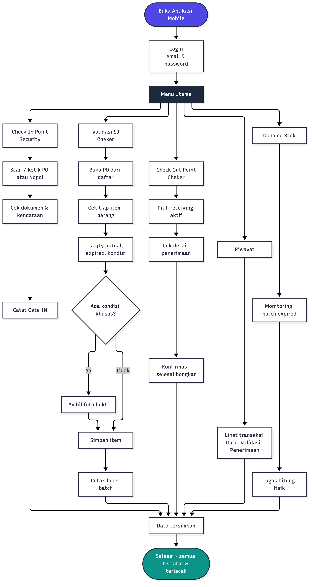
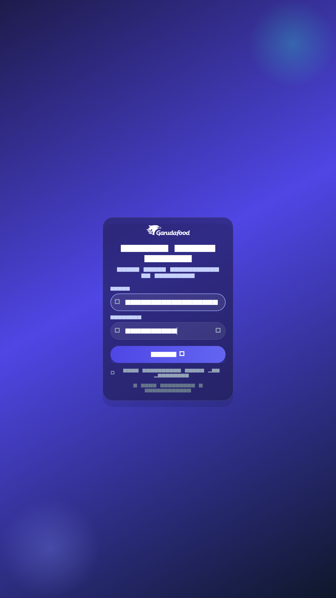

# Cara Kerja Aplikasi Mobile OneZentra (untuk pengguna awam)

> Semua penjelasan, flow, dan tampilan UI ada dalam satu file ini.

---

## 1. Tujuan Aplikasi (mudah dipahami)

Aplikasi mobile ini membantu petugas gudang (Security & Cheker) bekerja di lapangan
menggunakan HP, tanpa kertas. Semua dicatat otomatis dan bisa ditelusuri kembali.

**Manfaat utama bagi pengguna:**
- Tidak perlu tulis tangan / kertas hilang.
- Proses penerimaan barang lebih cepat.
- Data tersimpan dan bisa dicek ulang (riwayat).
- Setiap orang hanya melihat menu sesuai perannya.

---

## 2. Flow Cara Kerja (Chart)

Alur utama: **Login → Menu → Check In → Validasi SJ → Check Out → Riwayat/Opname → Selesai.**

---

## 3. Alur Kerja Sehari-hari (3 langkah utama)

### 3.1 Check In Point (Security)
1. Buka aplikasi → login.
2. Pilih **Check In Point**.
3. Scan atau ketik PO / Nopol kendaraan.
4. Periksa dokumen & kendaraan.
5. Catat **Gate IN**.

### 3.2 Validasi SJ (Cheker)
1. Pilih **Validasi SJ** → buka PO dari daftar.
2. Cek tiap item barang satu per satu.
3. Isi qty aktual, tanggal expired, dan kondisi barang.
4. Jika kondisi khusus → ambil foto bukti.
5. Simpan → cetak label batch otomatis.

### 3.3 Check Out Point (Cheker)
1. Pilih **Check Out Point** → pilih receiving aktif.
2. Cek detail penerimaan.
3. Konfirmasi **selesai bongkar**.

---

## 4. Fitur Pendukung

- **Riwayat** — lihat semua transaksi Gate, Validasi, dan Penerimaan.
- **Opname Stok** — monitoring barang mendekati expired & tugas hitung fisik.
- **Tema** — ganti terang/gelap sesuai kenyamanan.
- **Ganti Server** — alamat server bisa diubah dari layar login bila perlu.

---

## 5. Hasil Akhir

Semua transaksi tersimpan dan terlacak: dari kendaraan masuk (Gate IN), validasi
barang, sampai bongkar selesai (Check Out). Data ini menjadi dasar laporan dan
riwayat yang bisa dilihat kapan saja.

---

## 6. Tampilan UI Aplikasi (Mobile)

### 6.1 Layar Login — Tema Terang

### 6.2 Layar Login — Tema Gelap

### 6.3 Layar Login (input fokus) — Terang

### 6.4 Layar Login (input fokus) — Gelap

### 6.5 Layar Lainnya
Layar operasional (Check In, Validasi SJ, Check Out, Riwayat, Opname, Home Menu)
mengikuti design system yang sama (indigo primary, teal accent, Roboto) dan
mendukung mode terang/gelap. Contoh tampilan dapat dilihat langsung di aplikasi.

---

## 7. Contoh Implementasi Mobile (ringkas)

| Proses | Layar utama | Provider | Repository | Endpoint contoh |
|---|---|---|---|---|
| Login | `auth/pages/login_page.dart` | `AuthProvider` | `AuthRepository` | `POST /api/v1/mobile/login` |
| Check In | `gate/pages/gate_page.dart` | `GateProvider` | `GateRepository` | `POST /gate-transactions` |
| Validasi SJ | `validation/pages/validation_page.dart` | `ValidationProvider` | `ValidationRepository` | `POST /sj-validations/{id}/scan` |
| Check Out | `unload/pages/unload_page.dart` | `UnloadProvider` | `UnloadRepository` | `POST /receivings/{id}/complete` |
| Riwayat | `history/pages/history_page.dart` | — | Gate/Validation/Inbound Repo | `GET /gate-transactions`, `/sj-validations`, `/receivings` |
| Opname | `opname/pages/opname_expired*.dart` | — | Opname Repositories | `GET /opname-expired` |

Permission yang dipakai (contoh): `gate.view`, `gate.create`, `sj_validation.view`,
`receiving.view`, `receiving.edit`, `opname.view`, `opname.session.view`.

> Detail lengkap implementasi ada di `docs/MOBILE_IMPLEMENTATION_EXAMPLES.md`.